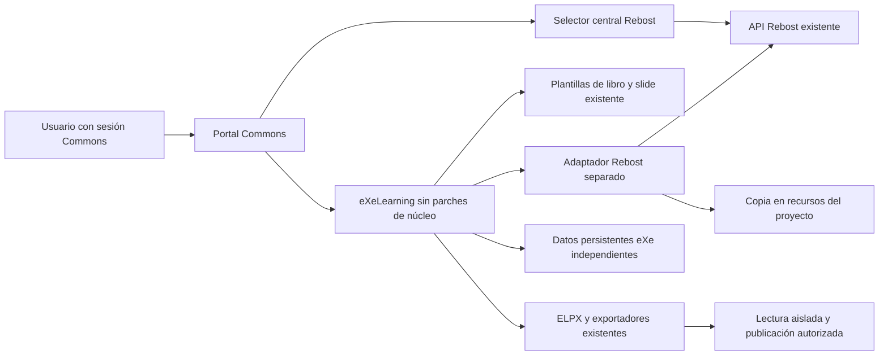

# EduTicTac Llibres: viabilidad de eXeLearning como motor

Fecha de investigación: **21 de octubre de 2026**. Estado: estudio de arquitectura;
no implementación, despliegue ni validación funcional de Llibres.

**Prioridad actualizada por el usuario:** el manejo desde iPad no es prioritario.
La decisión inicial se evaluará en ordenador, conservando accesibilidad y una
interfaz comprensible para Primaria. Tabletas e iPad quedan como mejora posterior.

## 1. Dictamen y decisión recomendada

**eXeLearning es un candidato viable, condicionado a una prueba de concepto.**
Dispone de estructura de páginas, plantillas, almacenamiento, API externa y
exportadores. No debe darse por demostrado que ya proporciona la experiencia de
un creador de libros para Primaria, ni un sistema completo de extensiones instalables.

El hallazgo más aprovechable es el iDevice existente **`slide`**: ya utiliza
Fabric.js y guarda una escena editable junto a una representación SVG para lectura.
Está presente tanto en `main` como en la versión estable examinada. No hace falta
empezar construyendo otro lienzo para comprobar el encaje. Véanse [E-SLIDE] y [E-RELEASE].

Recomendación, teniendo en cuenta que iPad no es prioritario:

1. Probar primero **A: eXeLearning con una configuración reducida, plantillas de
   libro y reutilización de `slide`**, incorporando Rebost mediante un adaptador
   independiente y los puntos de personalización previstos. Medir si la navegación
   y el guardado son suficientemente sencillos en ordenador.
2. Probar un iDevice «Página ilustrada» separado solo para cubrir carencias
   demostradas. No modificar los iDevices originales ni suponer que su instalador
   de extensiones funciona de extremo a extremo.
3. Si A fracasa por experiencia de uso, comparar **B** con **C** usando resultados
   concretos. B requiere mantener también un editor infantil y un adaptador al
   modelo de eXeLearning: no es una personalización pequeña.
4. Descartar eXeLearning como motor principal si exige un fork, manipular su DOM
   de forma extensa o resolver con credenciales compartidas la identidad infantil.

No se recomienda adoptar B de entrada solo para aprovechar exportadores: puede
sumar el coste de un editor propio y el de mantener dos modelos de documento.
Tampoco se recomienda construir C sin probar antes el componente libre ya existente.
Estos son juicios de arquitectura, no resultados de una prueba con alumnado.

## 2. Alcance, versiones y método

Se han inspeccionado el repositorio local de Commons y las fuentes de Blocs que
consumen Rebost, sin cambiar sus archivos. Commons está sobre `dfc25b0`, con cambios
locales de Rebost en curso: la auditoría refleja esos archivos de trabajo y no
afirma que estén publicados. Se han consultado documentación oficial y código
upstream descargado en un directorio temporal, sin instalar dependencias ni
ejecutar servicios o scripts de eXeLearning.

| Referencia | Versión fijada | Qué permite concluir |
|---|---|---|
| eXeLearning `main` | `e6a77cc822866cb9b6e3f46483744335a4f24212`, commit del 20-10-2026 | Arquitectura y capacidades actuales examinadas. |
| Última release estable indicada por GitHub al consultar | `v4.0.5`, `63748a3d87c8c3a757ef5f3479945db871ddb4c2`, publicada el 16-09-2026 | Base estable de comparación; no confundir con `main`. |
| Documentación web | Consultada el 21-10-2026 | Orientación; se contrasta con código cuando hay discrepancias. |

Comparación directa entre ambos árboles: son iguales las rutas de iDevices,
proyectos v1, recursos v1, autenticación v1 y el proveedor de recursos de exportación
por filesystem. Difieren autenticación general, exportador EPUB, Dockerfile,
documentación del editor incrustado y parte del ciclo de vida de `slide`.
No se atribuyen a 4.0.5 las mejoras posteriores sin comprobarlas.

Se abrió **sin ejecutar su contenido** el ejemplo oficial `doc/plugins/manual.es.elpx`:
ZIP de 159 entradas, `content.xml` con raíz ODE en el namespace INTEF y versión
`2.0`, recursos y HTML. Esto verifica el contenedor de ese ejemplo; no sustituye
una prueba de importación/exportación de un libro nuevo. [E-ELPX]

## 3. Arquitectura real de Commons y Rebost

| Componente inspeccionado | Estado real | Reutilización para Llibres |
|---|---|---|
| `compose.yml`, `services/portal/nginx/default.conf` | Portal nginx; rutas API hacia `id-api` y módulos opcionales por perfiles. | Entrada al módulo, proxy y despliegue opcional; no otro portal. |
| `services/id-api/main.py`, `requirements.txt` | FastAPI/Python, SQLite existente; OIDC mediante Authlib y sesiones de alumnado. | Identificación y autorización de Commons. |
| `services/id-api/assets/__init__.py` | Rebost integrado en `id-api`, con metadatos y PNG normalizados en SQLite. | Una única biblioteca privada y catálogo común. |
| `services/portal/public/assets/client.js` | Cliente MIT sin React, Redux o Scratch; exige mismo origen. | Consultar, leer y guardar imágenes desde otro editor. |
| `services/portal/public/assets/library.js` | Gestor y selector central en `/assets/`, textos es/va y selección por `postMessage`. | Botón «Elegir del Rebost» sin duplicar el gestor. |
| Blocs: `src/blocs/rebost.js`, `rebost-picker.jsx`, `rebost-save.js` | Adaptadores que incorporan bytes al proyecto nativo y conservan procedencia. | Patrón de integración; no copiar la GUI GPL a Commons como si fuera MIT. |
| `scripts/backup-stack.py` y procedimientos de backup | Infraestructura de copias del stack. | Ampliar el inventario de datos de un módulo nuevo; no asumir cobertura automática. |

Evidencia local: [contrato y límites de Rebost](rebost.md),
[acceso compartido](rebost-commons-access.md),
[plan central](assets-central-plan.md), [Compose](../compose.yml),
[cliente](../services/portal/public/assets/client.js) y
[API](../services/id-api/assets/__init__.py).

### Identidad, almacenamiento y límites existentes

- El propietario lo resuelve el servidor. Rebost admite sesión individual OIDC
  registrada en Commons o sesión activa de alumnado por código/PIN. Un token
  técnico o un rol docente no concede una biblioteca humana compartida.
- Los recursos privados no tienen URL pública reutilizable. La identidad OIDC
  de Rebost distingue emisor y sujeto; no se debe vincular por correo o nombre.
- El cliente y selector actuales requieren mismo origen. Las comprobaciones de
  mensaje incluyen origen, ventana emisora y petición activa.
- Imágenes admitidas: PNG, JPEG y WebP estáticos, normalizados a PNG, máximo
  5 MiB y 4096 × 4096. **Rebost no almacena todavía narraciones, documentos de
  libro, escenas editables ni SVG subidos por usuarios.**
- Las tablas de recursos viven en `data/id.db`, montado en `/data`; el catálogo
  versionado viaja con la imagen. Hay 51 imágenes propias y 61 de Scratch; las
  888 restantes del catálogo auditado siguen pendientes de revisión/incorporación.
- Cada proyecto consumidor conserva sus copias. Borrar del Rebost no debe romper
  un libro que ya incorporó esas imágenes.

La compartición por grupo/centro y la revocación remota inmediata desde el
proveedor OIDC no están resueltas completamente. Llibres debe respetar estas
limitaciones, sin convertir Rebost en un almacén público de libros. [C-IDENTIDAD]

Commons también tiene integración con Recursos y Play, pero no se ha encontrado
un contrato genérico que acepte ya cualquier libro HTML/EPUB de eXeLearning.
La publicación necesitará su adaptador, permisos y revisión docente; véase
[integración actual de Recursos](resources-integration.md).

## 4. Arquitectura actual de eXeLearning

La versión investigada es **eXeLearning 4**, no el editor Python clásico ni la
arquitectura PHP de etapas anteriores. Sus componentes son Bun, Elysia, Kysely,
frontend principalmente JavaScript sin framework, plantillas Nunjucks y Yjs.
Puede trabajar como servidor, distribución estática/incrustada y aplicación
de escritorio. No se necesita Electron para Commons. [E-ARQ]

En edición, el documento Yjs del navegador es la fuente de verdad; el servidor
sincroniza cambios, persiste estado y puede reconstruir documentos para operaciones
externas. No es correcto sustituirlo por escrituras directas en tablas SQL.
Las imágenes tienen gestión propia, con IndexedDB/caché en navegador y archivos
de proyecto persistidos en servidor. [E-YJS]

Su modelo distingue **proyecto → páginas → bloques → componentes/iDevices**.
Sirve para representar un libro con una página de eXeLearning por página del libro,
sin obligar al alumnado a manejar bloques anidados. Que la estructura lo permita
no demuestra que la interfaz de autoría predeterminada sea apropiada para Primaria.

Se admiten SQLite, PostgreSQL y MySQL/MariaDB. Para una prueba pequeña puede
usarse una **SQLite propia de eXeLearning**, evitando un nuevo servidor de base
de datos. No reutilizar `id.db` ni el esquema de Authentik: son datos y migraciones
de aplicaciones distintas. [E-DB]

## 5. iDevices y extensiones independientes

### Estructura y ciclo de vida

Un iDevice contiene `config.xml`, scripts y estilos de edición y de exportación,
icono y, cuando corresponde, plantilla de salida. El manifiesto declara nombre,
versión, tipo de componente, API, archivos y licencia. Los componentes JSON
permiten conservar datos reeditables además del HTML de lectura. El ejemplo
`text` expone `init(element, previousData)` y `save()`; para este tipo `save()`
devuelve datos JSON o `false` si falla la validación. No todos los iDevices usan
el mismo patrón de persistencia. [E-CONFIG] [E-TEXT]

La nueva edición de «Página ilustrada» deberá destruir lienzo, listeners,
temporizadores, URLs Blob y grabador al cerrarse. Existe una infraestructura
upstream de ciclo de vida; la versión exacta elegida debe comprobarse antes de
usarla, en vez de depender indefinidamente del global `$exeDevice`. [E-LIFECYCLE]

### Lo que sí está implementado y lo que no queda acreditado

| Hallazgo en código | Consecuencia |
|---|---|
| `src/routes/idevices.ts` escanea `public/files/perm/idevices/base` y `users`. | Se pueden descubrir directorios de iDevices añadidos por la instalación. |
| Los iDevices de `users` prevalecen al listar si comparten ID con uno base. | Usar ID propio y no sobrescribir `slide` o `text`. |
| El frontend y `api-routes.ts` anuncian upload/delete/download de extensiones. | Una declaración de ruta o un botón no demuestra que el backend la implemente. |
| No se ha localizado el manejador del instalador `POST /api/idevices/upload` en el árbol de rutas inspeccionado. | No prometer instalación/actualización ZIP desde la UI; verificar en PoC o contrastar con upstream. |
| `FileSystemResourceProvider.fetchIdeviceResources()` busca exportación bajo `base/<tipo>/export`. | Que un iDevice aparezca desde `users` no garantiza exportación correcta por REST/CLI. |
| `idevice-config.ts` usa por defecto el directorio `base`. | También hay que verificar configuración, render y exportación del iDevice nuevo. |

Evidencia: [E-IDEVICES], [E-ROUTES], [E-RESOURCES], [E-IDEVICE-CONFIG]. Los archivos
de las cuatro primeras comprobaciones relevantes se han contrastado con 4.0.5.
La ausencia de un manejador se informa como resultado de inspección, no como un
404 reproducido arrancando la aplicación.

**Vía sin fork que merece probarse:** mantener el iDevice en un repositorio o
paquete separado y montar únicamente su directorio, de solo lectura, bajo
`/app/public/files/perm/idevices/base/edutictac-pagina-ilustrada/`. Alternativamente,
crear una imagen derivada que añada ese directorio a una imagen upstream fijada.
Se añaden archivos propios y no se parchean archivos originales. Esta vía evita
un fork de código, pero sigue dependiendo de convenciones internas y necesita
pruebas de descubrimiento y exportación. No es un gestor oficial de plugins.

Actualizar el paquete implica versiones, migraciones de su propio JSON, pruebas
con proyectos antiguos y rollback. No se ha acreditado un registro de extensiones,
resolución automática de dependencias, aislamiento de scripts o garantía de
compatibilidad semántica de API. La instalación será de administración, con código
revisado; nunca permitir al alumnado cargar iDevices ejecutables arbitrarios.

### Personalización visual sin tocar núcleo

Existen `custom.css`, `custom.js`, un hook `$eXeLearningCustom.init()` y
personalización administrable de nombre, favicon y cabecera. Son vías razonables
para identidad visual, controles sencillos y un adaptador acotado. Los estilos
de contenido y plantillas de libro son distintos de la interfaz del editor.
Ocultar controles por CSS no sustituye permisos. [E-CUSTOM]

Los «Custom Assets» administrativos se sirven públicamente: **no son una
alternativa al Rebost privado**. No colocar ahí imágenes personales o narraciones.

## 6. API REST: posibilidades y límites

La API externa está en `/api/v1`, con documentación Swagger en `/api/v1/docs`.
La API interna del editor es otro contrato. Para una integración nueva se debe
preferir v1 y comprobar las rutas reales de la versión fijada. [E-API-INDEX]

| Necesidad de Llibres | Operación constatada en código v1 |
|---|---|
| Crear/listar libros | `POST /projects`, `GET /projects` |
| Consultar, renombrar, borrar, duplicar | `GET`, **`PATCH`**, `DELETE /projects/:uuid`; `POST /projects/:uuid/duplicate` |
| Añadir y reordenar páginas | Rutas de páginas y `POST /projects/:uuid/pages/:pageId/move` |
| Añadir bloques y contenido | Rutas de bloques y componentes; `POST /projects/:uuid/blocks/:blockId/components` |
| Guardar escena y vista de lectura | `PUT /projects/:uuid/components/:componentId`, con `jsonProperties` y `htmlView`/`htmlContent` |
| Metadatos | `GET`, `PATCH /projects/:uuid/metadata` |
| Incorporar recursos binarios | `POST /projects/:uuid/assets`, multipart con `file`, `clientId` y `folderPath` opcionales |
| Exportar | `GET /export/projects/:uuid/export/:format`; formatos en `GET /export/formats` |

Prefijar todas las rutas anteriores con `/api/v1`. Evidencia: [E-PROJECTS],
[E-PAGES], [E-COMPONENTS], [E-ASSETS-API], [E-EXPORT-API]. La documentación general
indica `PUT` para actualizar proyecto; el código examinado implementa `PATCH`.
Además, documentación e índice informativo anuncian exportar bajo
`/api/v1/projects/:uuid/export/:format`, pero la composición del router añade
`/export` y las pruebas upstream usan `/export/projects/:uuid/export/:format`.
La ruta que se deduce del código es
**`/api/v1/export/projects/:uuid/export/:format`**: comprobarla en la PoC.
No copiar ejemplos de documentación sin contrastarlos.

`authenticateRequest()` exige **Bearer JWT**, verifica mediante la autenticación
de eXeLearning y rechaza invitados. La cookie de Commons por sí sola no sirve
para v1; tampoco sirve un access token cualquiera emitido por Authentik.
El JWT local identifica al usuario interno de eXeLearning. [E-API-AUTH]

Las operaciones sobre contenido pasan por el documento Yjs y sincronizan cambios.
Para B habrá que comprobar atomicidad, reintentos, duplicados y conflictos cuando
una acción infantil implica varias llamadas. No hay en las rutas examinadas un
`POST /books/from-json` ni una transacción de libro completo documentada. [E-COMPONENTS]

El cierre/revocación de una sesión de Commons no invalida automáticamente un JWT
local ya entregado a eXeLearning. En B, el backend de integración debe autorizar
cada solicitud con la sesión Commons vigente y mantener el token upstream fuera
del navegador. No dar acceso directo adicional que eluda esa comprobación.

## 7. Autenticación y permisos con Commons

### Personas con cuenta OIDC

Es viable **configurar eXeLearning como otro cliente OIDC de Authentik** mediante
`APP_AUTH_METHODS=openid`, cliente propio, discovery y callback específico
`/login/openid/callback` con el prefijo público correspondiente. Comparte proveedor,
no cookies, bases de datos o contraseñas. Probar inicio, expiración, cierre,
desactivación y URL de vuelta. [E-AUTH]

Existe una discrepancia que afecta al diseño: la documentación afirma resolución
por `sub`, pero el callback inspeccionado busca primero por **correo** mediante
`findUserByEmail` y, al crear, registra `user_id: oidc:<subject>`. Sucede también
en 4.0.5. No afirmar que ya implementa una vinculación robusta por `(issuer, sub)`.
Antes de adoptar A, probar colisiones/cambios de correo y cuentas locales previas;
si la política de identidad exige cambiar núcleo y upstream no lo resuelve,
considerarlo motivo para descartar esa modalidad. [E-AUTH-CODE]

Configurar discovery/JWKS correctamente: el código incluye un camino de decodificación
de `id_token` sin verificar firma cuando no hay JWKS. Una instalación de Commons
no debe depender de ese fallback. Hay que probar también rechazo de firma/emisor
incorrectos y permisos de proyecto, no solo que aparezca la pantalla de entrada.

### Alumnado con código/PIN

**No hay integración lista para usar.** Esa sesión de Commons no convierte al
alumno en usuario OIDC de eXeLearning. No crear una única cuenta infantil compartida
ni convertir el PIN en contraseña de otra aplicación.

Alternativas para la prueba, sin implementarlas ahora:

- A online: resolver una delegación o acceso de plataforma soportado y una
  correspondencia individual verificable. El contrato de integración LMS con JWT
  y callbacks es una pista, no una garantía de identidad/propiedad equivalentes.
- Editor estático incrustado: Commons conserva sesiones y archivos; eXeLearning
  se usa como editor/exportador en navegador. Evita cuentas eXe, pero requiere
  almacenamiento de libros en Commons y no proporciona por sí mismo una UI infantil.
- B: adaptador backend que comprueba la sesión Commons y actúa como el usuario
  eXe correspondiente. Aprovisionamiento y vinculación son trabajo nuevo, con
  credenciales exclusivamente de servidor; evaluar si es menor coste que C.

La integración de plataforma tiene allowlist de callbacks y restricciones SSRF;
no se debe suponer que acepta directamente URLs privadas de Tailnet. No usar
secretos de Authentik o de la sesión Commons como clave JWT de eXeLearning.
[E-PLATFORM] [E-DEPLOY]

## 8. Integración con Rebost y exportaciones autosuficientes

Flujo propuesto, reutilizando el contrato central:

1. Abrir `/assets/` en modo selector bajo el mismo origen que Commons, con una
   petición identificada y tipo adecuado. No pedir `type=illustration` como
   filtro obligatorio si se quieren reutilizar también personajes y objetos.
2. Comprobar origen exacto, `event.source`, formato `rebost-selection`, versión,
   ID y petición activa. Volver a obtener metadatos y bytes con la sesión del usuario.
3. Capturar ID y revisión, validar tipo y límites, leer PNG, procedencia, fuente y
   licencia cuando existan y comprobar que la revisión sigue siendo la misma.
4. Incorporar el PNG al **almacén de recursos del proyecto eXeLearning**: vía
   `AssetManager` en una integración de editor o subida multipart v1 en B.
5. Usar el identificador asignado por eXeLearning en la referencia `asset://`.
   Guardar además procedencia `{rebostId, revision, atribución, licencia}` en datos
   de Llibres y recursos de créditos. No sustituir el ID central por el UUID eXe.
6. Verificar guardado, reapertura y exportación después de cerrar sesión y borrar
   el original privado de Rebost. El libro debe seguir funcionando con su copia.

Referencias internas típicas: `asset://<uuid>` o `asset://<uuid>.png`; al serializar
ELPX pasan a `{{context_path}}/<ruta-de-exportación>`, y el exportador escribe los
bytes bajo `content/resources/…`. No guardar `/api/assets/v1/…/content`, URLs Blob
o direcciones de una instalación como dependencias permanentes. [E-ASSET-FORMAT]

El SDK actual del Rebost no concede acceso entre orígenes. Para A, alojar el editor
de autoría bajo un prefijo del portal es una opción de laboratorio. Si se usa otro
dominio, necesitará un puente autenticado y limitado; no basta con habilitar CORS.
El puente jamás debe ofrecer «descargar cualquier ID» con una cuenta privilegiada.

El `slide` existente ya tiene `SlideAssetService`, que usa el gestor de archivos y
`AssetManager` de eXeLearning. No hay un proveedor Rebost intercambiable documentado:
adaptar ese flujo desde personalización o desde un iDevice propio es parte de la
PoC. Usar globales `_yjsBridge` se considera dependencia interna, no API estable.
[E-SLIDE-ASSETS]

Mantener fuentes y licencias completas de los recursos que lo requieran, además
de una página de créditos visible. Las fuentes SVG descargadas de Rebost deben
viajar como archivos inertes, sin insertarlas ni ejecutarlas; no confundirlas con
la vista SVG saneada que genera el propio lienzo. Cada exportador debe demostrar
que conserva los archivos de atribución y fuente, incluso si no son imágenes
visibles. No asumir que incluir un PNG conserva automáticamente su licencia.

**Dirección inversa:** un dibujo de Llibres podría guardarse explícitamente como
PNG en Rebost con el cliente común. La escena editable y el libro permanecen en
Llibres/eXeLearning. Si deriva de catálogo, respetar el contrato de procedencia
de Rebost; para composiciones con varias fuentes puede necesitarse una ampliación
antes de permitir su guardado. No eliminar créditos para forzar una subida.

## 9. ELPX, JSON e IA externa

`.elpx` es un ZIP, **no un JSON renombrado**. El formato actual utiliza `content.xml`
ODE 2.0 y recursos. El exportador añade HTML, estilos, runtime, tema, DTD y
miniatura. El importador puede reconstruir a partir de menos archivos, pero eso
no convierte un paquete mínimo de importación en una publicación completa.
[E-ELPX] [E-IMPORT]

La documentación distingue varios patrones de almacenamiento por iDevice.
Para un libro editable se deben conservar conjuntamente datos de escena y vista
de lectura: un HTML que se ve bien puede haber perdido toda la información de
edición. Mantener `.elpx` como fuente editable incluso si la publicación omite
su `content.xml`. En el editor incrustado, las capacidades y la política de
`forceEditableSource` dependen de la versión. [E-PATTERNS] [E-EMBED]

Propuesta de contrato de entrada, **todavía no implementado**:

```json
{
  "format": "llibres-project",
  "version": 1,
  "title": "El bosc de les històries",
  "language": "va",
  "assets": [
    {"id": "bosc", "type": "background", "description": "Bosc mediterrani", "file": null}
  ],
  "pages": [
    {"id": "pagina-1", "template": "imatge-text", "text": "Un dia…", "background": "bosc"}
  ]
}
```

El nombre técnico definitivo del formato se fijará en la PoC. La IA solo devuelve
JSON de contenido y descripciones; no HTML, JS, rutas de servidor o proyectos
ZIP arbitrarios. Un validador local debe limitar tipos, tamaños, páginas y objetos,
rechazar claves peligrosas y producir errores comprensibles sin ejecutar nada.

Mantener exactamente el flujo **copiar prompt → servicio externo elegido por el
usuario → pegar JSON → revisar → vincular imágenes → abrir**. Sin claves de IA,
SDKs comerciales, inferencia obligatoria ni envío de imágenes desde Commons.
No incluir imágenes Base64, información personal o credenciales en el prompt.

Dos compilaciones posibles a estudiar:

- JSON validado → llamadas v1 a proyecto/páginas/componentes/recursos. Reintentos
  idempotentes desde el adaptador, sin acumular páginas duplicadas por fallo parcial.
- JSON validado → `content.xml` y recursos mediante un generador determinista y
  plantillas fiables → importar `.elpx` con mecanismos de eXeLearning. No pedir a la
  IA que invente IDs ODE o XML complejo. [E-AI]

Estados de imágenes del libro: **Disponible**, **Pendiente** y **No encontrado**.
Son estado del proyecto, no entradas vacías en Rebost. Se deben importar textos,
orden y lógica del libro aun sin ilustraciones. Los marcadores llevan texto
alternativo; nunca sustituir silenciosamente el personaje por otro.

Importación ELPX futura: límites al tamaño comprimido y expandido, número de
archivos y XML; rechazo de rutas absolutas, `..`, enlaces y expansiones peligrosas.
Validar contra esquemas locales y deshabilitar entidades externas/red. No instalar
código de un iDevice recibido en un paquete de alumnado. Una exportación eXe
puede contener JS legítimo de su runtime; eso no autoriza ejecutar scripts escritos
en la respuesta de IA o procedentes de archivos importados sin confianza.

## 10. «Página ilustrada», Fabric.js y Konva.js

### Reutilización preferente: `slide`

El iDevice `slide` ya incluye texto, imágenes, formas, capas/orden visual,
deshacer/rehacer, tamaño y fondo, serialización y una instantánea SVG saneada.
Su payload contiene `version`, `engine: "fabric"`, dimensiones, `fabric` y `svg`.
Su lectura exportada usa SVG y no necesita cargar Fabric para reconstruir un
lienzo interactivo. Las imágenes de la escena tienen que conservar referencias
exportables, también dentro de SVG y JSON. [E-SLIDE-SERIAL] [E-SLIDE-EXPORT]

Esto aproxima una página ilustrada, pero no equivale a un libro completo. No se
ha comprobado en su interfaz un lápiz de dibujo libre o narración por página:
el código de «draw» de formas describe arrastrar para crear figuras geométricas.
No presentarlo como dibujo libre ya disponible.

### Si hace falta un iDevice propio

Un iDevice independiente puede guardar un JSON de página versionado, vista estática,
texto semántico y referencias a imágenes/audio del proyecto. Controles mínimos:
texto, imagen, lápiz, borrar, deshacer, fondo, grabar y escuchar. La página del
libro seguirá siendo una página eXe; no anidar todo el libro dentro de un solo
iDevice, lo que duplicaría navegación y dificultaría EPUB/SCORM.

| Biblioteca libre | Aporta | Trabajo que queda en Llibres |
|---|---|---|
| Fabric.js, MIT | Objetos editables, texto, imágenes, pinceles, transformaciones, JSON y SVG; ya incluida por eXeLearning. | UX, validación, integración Rebost, guardado, accesibilidad y migraciones. |
| Konva.js, MIT | Escena/capas y eventos; transformaciones y soporte de entrada táctil. | Edición de texto mediante controles DOM, modelo persistente propio, pincel y render accesible/exportable. |

**Preferir Fabric.js para esta PoC** por reutilización comprobada, sin introducir
una segunda biblioteca de lienzo. Konva sigue siendo candidata para C si una
prueba muestra una ventaja concreta. Ninguna es un editor de libros completo.
Sus licencias permisivas no alteran las obligaciones de los componentes eXe
que se reutilicen. [G-FABRIC] [G-KONVA]

Un lienzo requiere equivalentes DOM accesibles: listado de objetos, edición de
texto normal, botones de mover/reordenar y lectura con texto seleccionable y
alternativo. Para EPUB, evitar que la única información sea una imagen plana.
No admitir del JSON IA clases Fabric arbitrarias, SVG o URLs de red: construir
solo los objetos permitidos desde datos previamente validados.

### Narraciones

eXeLearning incluye grabación mediante `getUserMedia`/`MediaRecorder` en su código
común de edición; es infraestructura reutilizable, no un servicio de narración
ya integrado en Llibres. El audio debería guardarse como recurso del proyecto,
con límites y transcripción opcional; ampliar Rebost a audio será un hito aparte.
[E-AUDIO]

La captura de micrófono requiere contexto seguro y permiso del usuario.
La URL HTTP privada usada actualmente en el laboratorio no acredita grabación
en un dispositivo remoto. Preparar HTTPS válido en el entorno de prueba cuando
se evalúe esta función. Probar formatos reales del navegador y reproducción en
los lectores elegidos; no prometer MP3 si el navegador entrega WebM o MP4.
[G-MEDIA]

## 11. Publicación, HTML5, EPUB3 y SCORM

| Salida | Reutilización viable | Límite que hay que comprobar |
|---|---|---|
| `.elpx` | Fuente editable con recursos. | Reabrir mantiene objetos, imágenes, narración y créditos. |
| HTML5 y HTML5 de página única | Lectura web y copia descargable. | Navegación infantil y recursos locales; sin llamadas privadas a Rebost. |
| EPUB3 | Exportador nativo, manifiesto, navegación, XHTML y recursos. | No garantiza por sí solo maquetación fija, audio sincronizado ni comportamiento idéntico entre lectores. |
| SCORM 1.2 y 2004 | Paquete y runtime de comunicación con LMS. | «Leer libro» y «completar actividad» necesitan criterios propios; no atribuir evaluación a una página ilustrada. |
| IMS | Otro empaquetado ya contemplado. | No es prioritario para la primera prueba. |

Evidencia: [E-EXPORT-API], [E-EPUB] y
[contrato SCORM upstream](https://exelearning.github.io/exelearning/development/scorm12-runtime-contract/).
El exportador EPUB incluye páginas marcadas como `scripted`; los lectores pueden
limitar scripts. Mantener texto/imagen y audio con controles estándar como lectura
básica, sin exigir un canvas con JS. No se ha encontrado una garantía de exportación
tipo álbum de maquetación fija o Media Overlays; verificarlo como requisito aparte.

Separar **guardar**, **previsualizar**, **exportar** y **publicar/compartir**.
eXeLearning tiene en `main` una vista pública con aislamiento de contenido no
confiable en origen opaco; no se ha acreditado su presencia en la release 4.0.5
examinada. No activarla como sustituto de los permisos de Commons. [E-VIEW]

Publicación en Commons: autorización explícita, preferentemente revisión docente,
archivo de lectura separado del borrador y retirada posterior. Servir contenidos
exportados con sandbox/origen aislado; jamás como HTML activo junto a cookies
de Rebost/Commons. Un enlace no debe dar acceso al editor ni a bibliotecas privadas.
Retirar un enlace no recupera las copias ya descargadas.

## 12. Docker, persistencia y operación

**Viable sin un fork ni un servidor SQL adicional para el piloto.** Hay Dockerfile
upstream basado en Bun y ejemplo Compose con SQLite. El Dockerfile actual ejecuta
como usuario `bun`, expone 8080 y tiene healthcheck. El ejemplo de despliegue
contiene detalles heredados sobre nginx: contrastar siempre la imagen concreta
que se use. No asumir que todos los ejemplos describen el mismo runtime.
[E-DOCKER] [E-DEPLOY]

Diseño propuesto, sin crear todavía archivos Compose:

- Perfil opcional `llibres`; imagen upstream fijada por versión y digest, nunca
  actualización automática de `latest`. Verificar antes que el digest contiene
  los recursos y capacidades probados en el commit elegido.
- Un servicio eXeLearning en la red de Commons, sin exponer un puerto adicional
  al exterior si se accede por el portal. Autoría bajo prefijo dedicado, por
  ejemplo `/llibres-editor`, con `BASE_PATH` y callbacks coherentes.
- nginx del portal debe reenviar WebSocket además de HTTP. Probar prefijos de
  estáticos, Service Worker, redirecciones y descargas: no es solo un `proxy_pass`.
- Volumen propio en `/mnt/data`, `DB_PATH` y `FILES_DIR` persistentes. Mantener
  archivos, SQL, metadatos y correspondencias de identidad en las mismas copias
  coherentes. Directorios adicionales del iDevice y configuración, versionados.
- No compartir archivos de `id-api` ni el volumen de PostgreSQL de Authentik.
  No hacen falta Redis/HA para esta PoC; medir antes de plantear más servicios.
- Cuotas separadas para libros/audio, límites de carga/exportación y limpieza de
  temporales. El tope nginx de imágenes del Rebost no es el de libros completos.
- Añadir el volumen y configuración al backup de Commons, ensayar restauración
  aislada y reinicio, y conservar copia previa a migraciones. No borrar volúmenes
  para solucionar permisos ni suponer que una migración SQL es reversible.
- Secretos de aplicación y API propios, suministrados de forma segura. Nada de
  cuentas demo, invitado global o claves predeterminadas en un piloto con menores.

Hay una advertencia operativa local comprobada: una recreación con el tag general
de Commons sustituyó la API Rebost por otra sin sus rutas. Una futura PoC debe
usar proyecto/override e imágenes explícitos, sin cambiar los tags o servicios
actuales del laboratorio. Este estudio no ha recreado ningún contenedor.

## 13. Licencias: obligaciones y decisiones pendientes

El repositorio y Dockerfile declaran **AGPL-3.0-or-later**; `LICENSE` contiene el
texto AGPL v3. Mantener esta precisión frente al nombre abreviado «AGPL-3.0».
La revisión de licencia se apoya en el texto primario; no sustituye el análisis
del paquete final que se distribuya. [E-LICENSE]

Para el diseño propuesto:

- Conservar avisos, licencias y atribuciones. La distribución Docker/binaria debe
  cumplir entrega de código fuente correspondiente y condiciones de distribución.
- Si se ofrece una versión modificada por red, la sección 13 exige ofrecer de
  forma destacada a sus usuarios el código fuente correspondiente de esa versión.
- «Sin fork» no significa «sin obligaciones»: cambios de interfaz o extensiones
  integradas pueden formar una obra combinada. Publicar el código del adaptador,
  modificaciones y medios de construcción necesarios según su alcance.
- Comunicar procesos por HTTP no convierte automáticamente toda aplicación
  independiente de Commons en AGPL; tampoco basta separar contenedores para
  descartar una obra combinada. Revisar la vinculación y el código copiado reales.
- La licencia del software no impone automáticamente AGPL a textos, fotos o
  libros del alumnado; el código/runtime incluido en una exportación conserva
  sus propias condiciones.

**Hallazgo particular de reutilización:** los archivos del iDevice `slide` y su
`config.xml` declaran **CC BY-SA 4.0**, mientras que Fabric.js es MIT y la aplicación
eXeLearning es AGPL. No etiquetar una copia de ese iDevice como MIT ni asumir que
todo archivo del repositorio tiene idéntica licencia. Antes de extraerlo o crear
una derivada, aclarar el alcance de esos avisos con upstream y conservar autoría,
licencia e indicación de cambios. Se puede usar primero el componente incluido
sin extraer su implementación a Commons. [E-SLIDE] [G-FABRIC]

Rebost conserva licencias distintas por colección: gráficos propios GPL-3.0-only,
selección Scratch CC BY-SA 2.0 y subidas de autoría del usuario. La licencia de un
libro debe respetar la de cada imagen y las obligaciones de las adaptaciones;
una licencia general elegida en el libro no borra las anteriores. [C-LICENCIAS]

## 14. Comparación obligatoria A / B / C

Valoraciones cualitativas de trabajo y mantenimiento, no presupuestos medidos.

| Criterio | A. eXe + iDevices/personalización | B. Interfaz infantil + motor eXe | C. Editor independiente Fabric/Konva |
|---|---|---|---|
| Código inicial | Menor si `slide` y plantillas bastan; aumenta con iDevice propio. | Alto: editor infantil, adaptador REST, identidad y consistencia entre modelos. | Alto: editor, persistencia, lector, permisos y exportadores elegidos. |
| Rebost | Cliente/selector reutilizable; falta conexión al gestor de recursos eXe. | Control directo desde la UI Commons; copiar bytes a recursos eXe mediante adaptador. | Integración directa con API central y recursos del libro propio. |
| UX de Primaria | Riesgo principal: navegación, bloques, modales y guardado de eXe. CSS no garantiza simplificación. | Se diseña al nivel del alumnado; evitar que necesite abrir el editor completo. | Control completo de la experiencia y del modelo de libro. |
| Ordenador / iPad | Ordenador primero. iPad pendiente de evaluar, sin bloquear la decisión actual. | Ordenador primero; soporte táctil posterior propio. | Igual; una biblioteca con eventos táctiles no entrega toda la UX. |
| Funciones existentes | Páginas, plantillas, componentes, edición y exportación. | Almacenamiento/modelo/exportación reutilizados; UI avanzada eXe no se aprovecha automáticamente. | Fabric/Konva resuelven lienzo, no libros, publicación o SCORM. |
| Compatibilidad | Mejor con proyectos eXe si se conserva formato; iDevice propio necesita estar instalado para reeditar. | Conversión bidireccional limitada al subconjunto de libro; otros iDevices pueden quedar solo legibles. | Formato propio versionado; eXe requiere adaptador opcional futuro. |
| Licencias | AGPL, avisos de iDevices y recursos. | AGPL en lo reutilizado y análisis del adaptador/obra combinada. | MIT de lienzo; licencia propia y avisos de imágenes/runtime. |
| Docker | Un servicio eXe y datos propios; integración proxy/SSO. | eXe más backend de integración, preferiblemente dentro de la infraestructura disponible. | Cliente estático y persistencia en infraestructura Commons; no necesita runtime eXe. |
| Actualizaciones | Upstream y paquete/configuración; riesgo de hooks internos y exportación de plugins. | Upstream, API, esquema, migraciones y editor propio. | Dependencias de lienzo y código de libro propio; menos acoplamiento a eXe. |
| Mantenimiento largo plazo | Favorable solo si la personalización permanece pequeña y sin fork. | Puede ser el mayor: dos modelos y un editor propio. | Responsabilidad funcional mayor, con arquitectura potencialmente más pequeña si el alcance es libro simple. |
| Mejor escenario | eXe reducido supera prueba de alumnado y el adaptador es acotado. | Se necesitan muchas salidas eXe y la API cubre todo sin invadir sus internals. | Prioridad absoluta a libro visual sencillo y A/B obligan a mantener demasiada adaptación. |

La modalidad estática incrustada es una variante de reutilización de A, no una
cuarta promesa de motor REST. Su protocolo abre/guarda/exporta documentos y oculta
algunos menús; **no ofrece un API general de manipulación de páginas/objetos**
equivalente a v1. No sustituye B con un iframe invisible. [E-EMBED]

## 15. Arquitectura recomendada para la prueba



El diagrama representa la primera PoC A, no una integración ya existente. La
sesión de Commons autoriza Rebost; la sesión eXe autoriza el proyecto. El paso de
una a otra necesita la resolución de identidad descrita antes. Empezar con
identidades sintéticas; demostrar también código/PIN antes de adoptar para alumnado.

En B, interponer un backend autenticado que traduzca acciones de libro a v1 sin
exponer credenciales eXe; en C, sustituir únicamente el bloque editor/persistencia
de libro. En todos los casos Rebost conserva su API, privacidad y papel central.

## 16. Plan de prueba de concepto y pruebas de decisión

Esta tabla es trabajo futuro propuesto. **No se han ejecutado estos hitos.**
Prioridad: ordenador; tabletas se dejan fuera de los criterios obligatorios iniciales.

| Hito | Alcance acotado | Evidencia exigida |
|---|---|---|
| P0. Línea base | Versión/digest fijados, entorno Docker aislado, inventario de licencias y datos sintéticos. | Arranque, healthcheck, persistencia, backup/restauración; cero cambios al stack actual. |
| P1. Libro con lo existente | Plantilla de 3 páginas, `slide`, texto e imágenes; crear, duplicar y reordenar páginas. | Guardar, cerrar y reabrir sin pérdida de objetos; registrar pasos y fricciones reales. |
| P2. Rebost real | Selector central, imagen privada, imagen de catálogo y dibujo de Blocs previamente guardado en Rebost. | Mismos bytes y créditos, cero doble subida a biblioteca; libro independiente del original central. |
| P3. Identidad | Dos usuarios OIDC, dos alumnos código/PIN, caducidad/cierre/revocación. | Ninguno accede a proyectos o recursos ajenos; sin cuenta compartida ni vínculo solo por correo. |
| P4. Carencias de página | Evaluar lápiz y narración con componentes existentes; iDevice separado si hace falta. | Código propio versionado sin parches; instalar/actualizar/rollback y reeditar proyectos anteriores. |
| P5. IA por prompts | JSON limitado, plantillas y recursos pendientes. | Importación sin ilustraciones, vinculación posterior, estados claros; HTML/JS/URLs peligrosas rechazados. |
| P6. Portabilidad y lectura | ELPX, HTML5, EPUB3 y SCORM. | Abrir sin sesión, servidor y Rebost; comprobar contenido/créditos; EPUBCheck y lector de escritorio, SCORM en LMS de prueba. |
| P7. Usabilidad y mantenimiento | Prueba observada en ordenador y ensayo de actualización upstream. | El alumnado completa el flujo y se actualiza sin editar núcleo ni recuperar datos manualmente. |

Casos técnicos mínimos que deben automatizarse si se autoriza desarrollar la PoC:

1. Dos cuentas con imágenes distintas; IDs ajenas devuelven denegación sin filtrar
   contenido, incluso después de cerrar una sesión o cambiar usuario en otra pestaña.
2. Mensajes de selector falsificados, petición caducada o cancelada y origen/ventana
   incorrectos: ningún recurso incorporado.
3. Imagen renombrada/borrada mientras se elige: conflicto o aviso claro; sin datos
   parciales ni sustitución silenciosa.
4. Proyecto guardado/reabierto conserva orden, texto, posiciones, transparencias,
   datos de edición, narración y procedencia. Repetir sin cookies de Rebost.
5. Exportados sin referencias privadas, rutas absolutas o URLs Blob; recursos y
   licencias presentes. Ejecutar HTML sin red externa y comparar lectura.
6. JSON inválido, HTML con eventos, SVG malicioso, archivos camuflados, ZIP traversal,
   expansión excesiva y XXE: rechazo limitado y sin ejecutar contenido.
7. Interrupción de guardado o reintento: no se duplican páginas ni se anuncia éxito
   antes de persistir. Probar conflictos de edición que soporte la modalidad elegida.
8. Reiniciar y restaurar eXe conservando datos, identidades y permisos; mantener
   Commons/Rebost intactos. Ensayar actualización y reapertura de un proyecto anterior.
9. Interfaz y mensajes en castellano/valenciano, teclado, foco y lectura accesible.
   Grabación: permiso denegado y ausencia de micrófono no bloquean crear el libro.

Objetivo propuesto de usabilidad para decidir, a acordar con el centro: al menos
4 de 5 participantes de Primaria completan un libro de 3 páginas, eligen una imagen,
escriben, reordenan, guardan y leen sin ayuda continua tras una explicación breve.
Medir tiempo/errores, no solo satisfacción del adulto. No se exige prueba de iPad.

## 17. Riesgos y criterios de adopción/descarte

| Riesgo | Impacto | Criterio de resolución |
|---|---|---|
| UI de cursos demasiado compleja | Invalida el objetivo infantil. | P1/P7 con alumnado; si requiere reescritura DOM extensa, A no se adopta. |
| Instalador iDevices incompleto o exportación distinta en `users` | Extensiones visibles que luego no publican. | Directorio/paquete separado y todos los exportadores verificados; si exige parchear núcleo, rechazar esa vía. |
| OIDC vinculado por correo / código-PIN sin equivalente | Confusión de propiedad o exclusión de alumnado. | P3 obligatorio antes del piloto; nunca cuenta compartida. |
| Acoplamiento a `_yjsBridge`, DOM o contratos internos | Roturas al actualizar. | Inventariar cada dependencia y ejecutar contratos con siguiente versión. |
| Escena solo como imagen o SVG | Pérdida de edición o accesibilidad. | Datos de objetos reabribles y texto semántico verificables. |
| EPUB dependiente de JS o layout distinto | Libro ilegible en lectores elegidos. | P6; aceptar un subconjunto estático documentado o descartar si no cubre la necesidad. |
| HTML/JS de contenido junto a cookies Commons | Acceso indebido a datos privados. | Publicación aislada; generador restringido y límites de importación. |
| Audio y libros sin cuotas/backups propios | Disco agotado o datos perdidos. | P0/P4 con límites y restauración; audio no se añade informalmente a Rebost. |
| Licencias heterogéneas de iDevices y catálogos | Reutilización/distribución incorrecta. | Inventario y aclaraciones de los componentes concretos antes de extraer/redistribuir. |

**Adoptar A** si cumple experiencia infantil en ordenador, identidad individual,
Rebost autosuficiente al exportar, formatos necesarios y actualizaciones sin fork,
con personalización pequeña documentada.

**Adoptar B** solo si una prueba mínima demuestra crear/guardar/reabrir/exportar
un libro completo por API pública, mantener permisos y datos de escena, y que el
coste de su adaptador resulta menor que mantener los exportadores necesarios en C.
No adoptar B basándose solo en que existe un CRUD REST.

**Elegir C** si A complica el uso y B necesita demasiados internals, un fork o
doble modelo difícil de mantener. Mantener Rebost e identidad Commons, formato
versionado y lector HTML accesible; EPUB/SCORM se evaluarán según necesidades,
sin prometerlos como gratuitos por elegir Fabric o Konva.

Descartar eXeLearning como motor no impide ofrecerlo después como herramienta
docente o destino de intercambio. La prioridad de Llibres es que el alumnado cree
y lea libros con facilidad, no reproducir toda la funcionalidad de eXeLearning.

## 18. Fuentes primarias y trazabilidad

Los enlaces de código siguientes fijan el commit investigado. La documentación
web puede evolucionar; para reproducir, usar su archivo `doc/` en ese commit.
Los identificadores entre corchetes del informe remiten a esta lista.

- **E-RELEASE:** [release estable 4.0.5](https://github.com/exelearning/exelearning/releases/tag/v4.0.5).
- **E-ARQ:** [arquitectura](https://github.com/exelearning/exelearning/blob/e6a77cc822866cb9b6e3f46483744335a4f24212/doc/architecture.md).
- **E-YJS:** [tiempo real](https://github.com/exelearning/exelearning/blob/e6a77cc822866cb9b6e3f46483744335a4f24212/doc/development/real-time.md).
- **E-DB:** [cliente de base de datos](https://github.com/exelearning/exelearning/blob/e6a77cc822866cb9b6e3f46483744335a4f24212/src/db/client.ts).
- **E-CONFIG:** [contrato config.xml](https://github.com/exelearning/exelearning/blob/e6a77cc822866cb9b6e3f46483744335a4f24212/doc/elpx-format/idevices/config-xml.md).
- **E-TEXT:** [edición del iDevice text](https://github.com/exelearning/exelearning/blob/e6a77cc822866cb9b6e3f46483744335a4f24212/public/files/perm/idevices/base/text/edition/text.js).
- **E-LIFECYCLE:** [ADR de ciclo de vida de edición](https://github.com/exelearning/exelearning/blob/e6a77cc822866cb9b6e3f46483744335a4f24212/doc/architecture/adr/ADR-2293-01-own-idevice-edition-resources-with-an-explicit-lifecycle.md).
- **E-IDEVICES:** [rutas y descubrimiento](https://github.com/exelearning/exelearning/blob/e6a77cc822866cb9b6e3f46483744335a4f24212/src/routes/idevices.ts).
- **E-ROUTES:** [declaraciones de rutas](https://github.com/exelearning/exelearning/blob/e6a77cc822866cb9b6e3f46483744335a4f24212/src/routes/api-routes.ts).
- **E-RESOURCES:** [proveedor de exportación por filesystem](https://github.com/exelearning/exelearning/blob/e6a77cc822866cb9b6e3f46483744335a4f24212/src/shared/export/providers/FileSystemResourceProvider.ts).
- **E-IDEVICE-CONFIG:** [carga de configuración](https://github.com/exelearning/exelearning/blob/e6a77cc822866cb9b6e3f46483744335a4f24212/src/services/idevice-config.ts).
- **E-CUSTOM:** [personalización](https://github.com/exelearning/exelearning/blob/e6a77cc822866cb9b6e3f46483744335a4f24212/doc/development/customization.md).
- **E-API-INDEX:** [router v1 y Swagger](https://github.com/exelearning/exelearning/blob/e6a77cc822866cb9b6e3f46483744335a4f24212/src/routes/api/v1/index.ts).
- **E-PROJECTS:** [proyectos v1](https://github.com/exelearning/exelearning/blob/e6a77cc822866cb9b6e3f46483744335a4f24212/src/routes/api/v1/projects.ts).
- **E-PAGES:** [páginas v1](https://github.com/exelearning/exelearning/blob/e6a77cc822866cb9b6e3f46483744335a4f24212/src/routes/api/v1/pages.ts).
- **E-COMPONENTS:** [componentes v1](https://github.com/exelearning/exelearning/blob/e6a77cc822866cb9b6e3f46483744335a4f24212/src/routes/api/v1/components.ts).
- **E-ASSETS-API:** [recursos binarios v1](https://github.com/exelearning/exelearning/blob/e6a77cc822866cb9b6e3f46483744335a4f24212/src/routes/api/v1/assets.ts).
- **E-EXPORT-API:** [exportación v1](https://github.com/exelearning/exelearning/blob/e6a77cc822866cb9b6e3f46483744335a4f24212/src/routes/api/v1/export.ts).
- **E-API-AUTH:** [autorización y esquemas v1](https://github.com/exelearning/exelearning/blob/e6a77cc822866cb9b6e3f46483744335a4f24212/src/routes/api/v1/types.ts).
- **E-AUTH:** [documentación de autenticación](https://exelearning.github.io/exelearning/development/authentication/).
- **E-AUTH-CODE:** [implementación de autenticación](https://github.com/exelearning/exelearning/blob/e6a77cc822866cb9b6e3f46483744335a4f24212/src/routes/auth.ts).
- **E-PLATFORM:** [integración de plataforma](https://github.com/exelearning/exelearning/blob/e6a77cc822866cb9b6e3f46483744335a4f24212/src/routes/platform-integration.ts).
- **E-ASSET-FORMAT:** [referencias y ciclo de recursos](https://exelearning.github.io/exelearning/elpx-format/assets/).
- **E-ELPX:** [estructura ZIP ELPX](https://github.com/exelearning/exelearning/blob/e6a77cc822866cb9b6e3f46483744335a4f24212/doc/elpx-format/container.md).
- **E-IMPORT:** [proceso de importación](https://github.com/exelearning/exelearning/blob/e6a77cc822866cb9b6e3f46483744335a4f24212/doc/elpx-format/import-pipeline.md).
- **E-PATTERNS:** [patrones de datos de iDevices](https://github.com/exelearning/exelearning/blob/e6a77cc822866cb9b6e3f46483744335a4f24212/doc/elpx-format/idevices/patterns.md).
- **E-AI:** [generación documentada](https://github.com/exelearning/exelearning/blob/e6a77cc822866cb9b6e3f46483744335a4f24212/doc/elpx-format/ai-generation.md).
- **E-EMBED:** [contrato del editor incrustado](https://exelearning.github.io/exelearning/development/embedding/).
- **E-SLIDE:** [configuración y licencia de slide](https://github.com/exelearning/exelearning/blob/e6a77cc822866cb9b6e3f46483744335a4f24212/public/files/perm/idevices/base/slide/config.xml).
- **E-SLIDE-ASSETS:** [servicio de imágenes de slide](https://github.com/exelearning/exelearning/blob/e6a77cc822866cb9b6e3f46483744335a4f24212/public/files/perm/idevices/base/slide/src/assetService.ts).
- **E-SLIDE-SERIAL:** [serialización de slide](https://github.com/exelearning/exelearning/blob/e6a77cc822866cb9b6e3f46483744335a4f24212/public/files/perm/idevices/base/slide/src/serializer.ts).
- **E-SLIDE-EXPORT:** [lectura/exportación de slide](https://github.com/exelearning/exelearning/blob/e6a77cc822866cb9b6e3f46483744335a4f24212/public/files/perm/idevices/base/slide/export/slide.js).
- **E-AUDIO:** [grabación en código común de edición](https://github.com/exelearning/exelearning/blob/e6a77cc822866cb9b6e3f46483744335a4f24212/public/app/common/common_edition.js).
- **E-EPUB:** [exportador EPUB3](https://github.com/exelearning/exelearning/blob/e6a77cc822866cb9b6e3f46483744335a4f24212/src/shared/export/exporters/Epub3Exporter.ts).
- **E-VIEW:** [diseño del visor público aislado](https://github.com/exelearning/exelearning/blob/e6a77cc822866cb9b6e3f46483744335a4f24212/doc/architecture/adr/ADR-348-01-public-view-opaque-origin-isolation.md).
- **E-DOCKER:** [Dockerfile](https://github.com/exelearning/exelearning/blob/e6a77cc822866cb9b6e3f46483744335a4f24212/Dockerfile).
- **E-DEPLOY:** [despliegue y opciones](https://github.com/exelearning/exelearning/blob/e6a77cc822866cb9b6e3f46483744335a4f24212/doc/deployment.md) y [Compose SQLite](https://github.com/exelearning/exelearning/blob/e6a77cc822866cb9b6e3f46483744335a4f24212/doc/deploy/docker-compose.sqlite.yml).
- **E-LICENSE:** [texto AGPL del repositorio](https://github.com/exelearning/exelearning/blob/e6a77cc822866cb9b6e3f46483744335a4f24212/LICENSE) y [declaración SPDX del paquete](https://github.com/exelearning/exelearning/blob/e6a77cc822866cb9b6e3f46483744335a4f24212/package.json).
- **G-FABRIC:** [documentación Fabric.js](https://fabricjs.com/docs/) y [licencia MIT](https://github.com/fabricjs/fabric.js/blob/master/LICENSE).
- **G-KONVA:** [documentación Konva](https://konvajs.org/docs/overview.html) y [licencia MIT](https://github.com/konvajs/konva/blob/master/LICENSE).
- **G-MEDIA:** [W3C Media Capture and Streams](https://www.w3.org/TR/mediacapture-streams/).
- **C-IDENTIDAD:** [identidad y límites de Rebost](rebost.md#identidad-y-privacidad).
- **C-LICENCIAS:** [catálogo propio](rebost-catalog.md) y [selección Scratch](rebost-scratch.md).

## 19. Comprobaciones realizadas y límites del informe

- Lectura de arquitectura, rutas, SDK, permisos, persistencia, Compose y documentación
  locales de Commons/Rebost y del adaptador Blocs.
- Descarga temporal de fuentes upstream fijadas y comparación de archivos clave con
  4.0.5; consulta de release oficial, documentación, licencias y bibliotecas.
- Inspección de rutas implementadas frente a declaraciones/UI, búsqueda del instalador,
  comprobación de payload de `slide`, referencias de imágenes y proceso de exportación.
- Lectura no ejecutable del ZIP/XML de un ejemplo ELPX oficial.
- Revisión de enlaces y consistencia del documento nuevo.

No se han arrancado eXeLearning, probado sus API con cuentas reales, ejecutado
exportaciones nuevas, realizado pruebas con alumnado o evaluado iPad. No se ha
modificado producción, creado un módulo Llibres, conectado servicios externos de
IA, instalado dependencias, hecho commit ni desplegado cambios.

[E-RELEASE]: https://github.com/exelearning/exelearning/releases/tag/v4.0.5
[E-ARQ]: https://github.com/exelearning/exelearning/blob/e6a77cc822866cb9b6e3f46483744335a4f24212/doc/architecture.md
[E-YJS]: https://github.com/exelearning/exelearning/blob/e6a77cc822866cb9b6e3f46483744335a4f24212/doc/development/real-time.md
[E-DB]: https://github.com/exelearning/exelearning/blob/e6a77cc822866cb9b6e3f46483744335a4f24212/src/db/client.ts
[E-CONFIG]: https://github.com/exelearning/exelearning/blob/e6a77cc822866cb9b6e3f46483744335a4f24212/doc/elpx-format/idevices/config-xml.md
[E-TEXT]: https://github.com/exelearning/exelearning/blob/e6a77cc822866cb9b6e3f46483744335a4f24212/public/files/perm/idevices/base/text/edition/text.js
[E-LIFECYCLE]: https://github.com/exelearning/exelearning/blob/e6a77cc822866cb9b6e3f46483744335a4f24212/doc/architecture/adr/ADR-2293-01-own-idevice-edition-resources-with-an-explicit-lifecycle.md
[E-IDEVICES]: https://github.com/exelearning/exelearning/blob/e6a77cc822866cb9b6e3f46483744335a4f24212/src/routes/idevices.ts
[E-ROUTES]: https://github.com/exelearning/exelearning/blob/e6a77cc822866cb9b6e3f46483744335a4f24212/src/routes/api-routes.ts
[E-RESOURCES]: https://github.com/exelearning/exelearning/blob/e6a77cc822866cb9b6e3f46483744335a4f24212/src/shared/export/providers/FileSystemResourceProvider.ts
[E-IDEVICE-CONFIG]: https://github.com/exelearning/exelearning/blob/e6a77cc822866cb9b6e3f46483744335a4f24212/src/services/idevice-config.ts
[E-CUSTOM]: https://github.com/exelearning/exelearning/blob/e6a77cc822866cb9b6e3f46483744335a4f24212/doc/development/customization.md
[E-API-INDEX]: https://github.com/exelearning/exelearning/blob/e6a77cc822866cb9b6e3f46483744335a4f24212/src/routes/api/v1/index.ts
[E-PROJECTS]: https://github.com/exelearning/exelearning/blob/e6a77cc822866cb9b6e3f46483744335a4f24212/src/routes/api/v1/projects.ts
[E-PAGES]: https://github.com/exelearning/exelearning/blob/e6a77cc822866cb9b6e3f46483744335a4f24212/src/routes/api/v1/pages.ts
[E-COMPONENTS]: https://github.com/exelearning/exelearning/blob/e6a77cc822866cb9b6e3f46483744335a4f24212/src/routes/api/v1/components.ts
[E-ASSETS-API]: https://github.com/exelearning/exelearning/blob/e6a77cc822866cb9b6e3f46483744335a4f24212/src/routes/api/v1/assets.ts
[E-EXPORT-API]: https://github.com/exelearning/exelearning/blob/e6a77cc822866cb9b6e3f46483744335a4f24212/src/routes/api/v1/export.ts
[E-API-AUTH]: https://github.com/exelearning/exelearning/blob/e6a77cc822866cb9b6e3f46483744335a4f24212/src/routes/api/v1/types.ts
[E-AUTH]: https://exelearning.github.io/exelearning/development/authentication/
[E-AUTH-CODE]: https://github.com/exelearning/exelearning/blob/e6a77cc822866cb9b6e3f46483744335a4f24212/src/routes/auth.ts
[E-PLATFORM]: https://github.com/exelearning/exelearning/blob/e6a77cc822866cb9b6e3f46483744335a4f24212/src/routes/platform-integration.ts
[E-ASSET-FORMAT]: https://exelearning.github.io/exelearning/elpx-format/assets/
[E-ELPX]: https://github.com/exelearning/exelearning/blob/e6a77cc822866cb9b6e3f46483744335a4f24212/doc/elpx-format/container.md
[E-IMPORT]: https://github.com/exelearning/exelearning/blob/e6a77cc822866cb9b6e3f46483744335a4f24212/doc/elpx-format/import-pipeline.md
[E-PATTERNS]: https://github.com/exelearning/exelearning/blob/e6a77cc822866cb9b6e3f46483744335a4f24212/doc/elpx-format/idevices/patterns.md
[E-AI]: https://github.com/exelearning/exelearning/blob/e6a77cc822866cb9b6e3f46483744335a4f24212/doc/elpx-format/ai-generation.md
[E-EMBED]: https://exelearning.github.io/exelearning/development/embedding/
[E-SLIDE]: https://github.com/exelearning/exelearning/blob/e6a77cc822866cb9b6e3f46483744335a4f24212/public/files/perm/idevices/base/slide/config.xml
[E-SLIDE-ASSETS]: https://github.com/exelearning/exelearning/blob/e6a77cc822866cb9b6e3f46483744335a4f24212/public/files/perm/idevices/base/slide/src/assetService.ts
[E-SLIDE-SERIAL]: https://github.com/exelearning/exelearning/blob/e6a77cc822866cb9b6e3f46483744335a4f24212/public/files/perm/idevices/base/slide/src/serializer.ts
[E-SLIDE-EXPORT]: https://github.com/exelearning/exelearning/blob/e6a77cc822866cb9b6e3f46483744335a4f24212/public/files/perm/idevices/base/slide/export/slide.js
[E-AUDIO]: https://github.com/exelearning/exelearning/blob/e6a77cc822866cb9b6e3f46483744335a4f24212/public/app/common/common_edition.js
[E-EPUB]: https://github.com/exelearning/exelearning/blob/e6a77cc822866cb9b6e3f46483744335a4f24212/src/shared/export/exporters/Epub3Exporter.ts
[E-VIEW]: https://github.com/exelearning/exelearning/blob/e6a77cc822866cb9b6e3f46483744335a4f24212/doc/architecture/adr/ADR-348-01-public-view-opaque-origin-isolation.md
[E-DOCKER]: https://github.com/exelearning/exelearning/blob/e6a77cc822866cb9b6e3f46483744335a4f24212/Dockerfile
[E-DEPLOY]: https://github.com/exelearning/exelearning/blob/e6a77cc822866cb9b6e3f46483744335a4f24212/doc/deployment.md
[E-LICENSE]: https://github.com/exelearning/exelearning/blob/e6a77cc822866cb9b6e3f46483744335a4f24212/LICENSE
[G-FABRIC]: https://fabricjs.com/docs/
[G-KONVA]: https://konvajs.org/docs/overview.html
[G-MEDIA]: https://www.w3.org/TR/mediacapture-streams/
[C-IDENTIDAD]: rebost.md#identidad-y-privacidad
[C-LICENCIAS]: rebost-catalog.md
