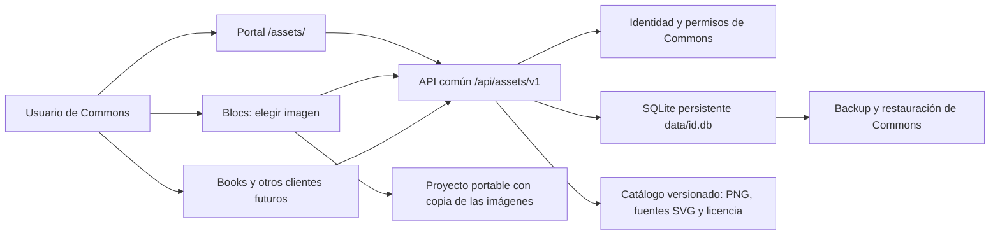

# Plan de biblioteca central EduTicTac Rebost

Estado actualizado el 20-10-2026: [núcleo central privado y gestor implementados localmente](rebost.md),
con pruebas de API, navegador y persistencia. Activados en el stack local, sin publicación externa. Blocs ya tiene un adaptador local
para elegir personajes, disfraces y fondos bajo el mismo origen, guardar dibujos desde el
pintor nativo y vincular recursos en la revisión de JSON IA.
Este documento conserva el plan completo; el [catálogo común inicial](rebost-catalog.md) también está implementado y probado localmente.
Los hitos de migración e integración con un segundo editor siguen pendientes. Blocs es el primer cliente local. Books queda fuera de la entrega inicial.

La vinculación posterior a abrir el proyecto ya está implementada en Blocs: **Archivo →
Imágenes del proyecto…** muestra Disponible/Pendiente/No encontrado y reutiliza el selector
y las subidas de Rebost. No es un segundo gestor ni un editor de imágenes dentro de Blocs.

Nombre de producto confirmado: **EduTicTac Rebost**. Las rutas, archivos e identificadores
técnicos `assets` se mantienen para conservar compatibilidad; no son el nombre mostrado.
En valenciano: **Guarda al Rebost** y **Tria del Rebost**; en castellano:
**Guardar en el Rebost** y **Elegir del Rebost**.

## Revisión de alcance: central primero

La [auditoría de duplicaciones con Blocs](rebost-blocs-audit.md) confirma que subir, dibujar,
girar, escalar, renombrar, duplicar y reutilizar localmente ya tienen recorridos existentes.
El núcleo y la elección central de personaje/fondo ya están implementados localmente. Se completarán después los demás recorridos.
El gestor/editor del prototipo de Blocs se ha retirado de su interfaz, conservando las imágenes.
No añadir otro editor gráfico en el MVP central. Mantener JSON v3 y recursos pendientes;
mantener la lectura compatible y preparar una migración explícita, sin borrar imágenes.
El contenido central conservará dimensiones generales: el ajuste a 480 × 360 corresponde
al adaptador de Blocs, nunca al almacenamiento común.

## 1. Resultado esperado

Una persona sube una imagen una sola vez. Puede elegirla como personaje o fondo en Blocs,
como ilustración en Books y, cuando tenga adaptador, en otra aplicación de Commons.
La biblioteca conserva la imagen original normalizada y sus metadatos; cada proyecto
incorpora una copia de la imagen que usa. Renombrar o eliminar la entrada de biblioteca
no modifica automáticamente los proyectos ya guardados.

La biblioteca tendrá una entrada propia **Rebost / Biblioteca de imágenes** en Commons.
Las aplicaciones mostrarán **Elegir del Rebost** dentro de sus flujos de creación.
La biblioteca gestiona imágenes. Importar/exportar proyectos completos de Blocs corresponde
al menú Archivo de Blocs. La importación de una imagen desde un proyecto será una acción
explícita y diferenciada.

### Dibujos creados en Blocs y catálogo existente

Se incluyen expresamente en el alcance de la biblioteca central estos dos flujos:

1. **Guardar un dibujo en el Rebost.** En Disfraces y Fondos, la acción **Guardar en el Rebost**
   (**Guarda al Rebost** en valenciano) actúa sobre la imagen seleccionada, con vista previa,
   nombre y tipo. Guarda una copia en **Mis imágenes / Les meues imatges**, privada por defecto,
   reutilizable desde las aplicaciones conectadas. No guarda programas ni el proyecto completo.
   Editar después el dibujo o la entrada no sincroniza ni sobrescribe la otra copia.
   Cada guardado muestra confirmación o error; sin sesión central válida ofrece guardar
   localmente con una indicación clara, sin anunciar que ya está disponible en Commons.
2. **Aprovechar el catálogo de Blocs.** El selector común ofrecerá **Catálogo EduTicTac /
   Catàleg EduTicTac** junto a **Mis imágenes / Les meues imatges**, con búsqueda y filtros.
   Incluir personajes, disfraces, fondos y objetos gráficos existentes solo después de
   inventariar los archivos y comprobar su procedencia, licencia y atribución. No asumir
   que toda imagen visible en un catálogo externo está incluida o puede redistribuirse.

En la primera versión, **Guardar en el Rebost** convierte la imagen seleccionada a PNG,
conserva transparencia y proporciones, muestra las dimensiones y aplica los mismos límites,
validación y normalización del servidor que una subida. También se rasterizan los disfraces
vectoriales; no se habilita SVG arbitrario por venir del editor. Conservar vectores editables
queda para una ampliación con saneamiento y pruebas específicas. La copia del proyecto
mantiene su formato y calidad originales; no se modifica para realizar el guardado.

El catálogo será una colección del sistema de solo lectura para los usuarios, con una sola
copia gestionada por instalación, independiente de las bibliotecas privadas. Elegir un recurso
lo incorpora al proyecto sin crear automáticamente otra entrada personal. **Editar una copia**
crea una imagen privada; ningún usuario modifica o elimina el original común. La lectura del
catálogo será una capacidad explícita, separada del acceso a imágenes privadas, sin convertir
al alumnado ni a una credencial técnica compartida en propietarios del catálogo.

Cada recurso del catálogo conservará autoría, licencia y enlace de procedencia comprobados,
avisos exigibles e identificador de origen. Registrar la licencia del recurso original también
en las copias derivadas, sin inventar autorías ni sustituir sus condiciones. Las aplicaciones
mostrarán las atribuciones exigidas y las conservarán en sus metadatos de proyecto cuando
corresponda; no se incluirá un recurso si no se puede cumplir su licencia en los usos previstos.

El inventario distinguirá los recursos empaquetados con Blocs de los que dependen de descargas
externas. La incorporación será local, versionada e idempotente, con un manifiesto de origen,
ID estable, hash, licencia y atribución por recurso; no dependerá de URLs remotas en tiempo de uso.
Se conservarán los IDs actuales del catálogo de Blocs y un mapa explícito a las IDs centrales:
no se cambiarán referencias de proyectos antiguos ni se mezclarán con los IDs lógicos de la IA.
Actualizar el catálogo no sobrescribirá entradas privadas ni alterará proyectos ya guardados.
El contenido compartido contará en el límite global de instalación, sin consumir por sí solo
la cuota personal de cada usuario; una copia privada tendrá las cuotas normales.

## 2. Arquitectura encontrada y consecuencias

| Componente | Estado comprobado | Consecuencia |
|---|---|---|
| Commons `id-api` | FastAPI, SQLite `data/id.db`, sesiones y grupos; proxy del portal `/api/`. | Puede alojar un módulo Rebost sin añadir contenedor ni motor de base de datos. |
| Identidad Commons | Docentes OIDC; alumnado con código/PIN y sesiones revocables; acceso a grupos comprobado en servidor. | Reutilizar ambas vías, sin exigir una cuenta Authentik al alumnado. |
| Identidad Blocs | SQLite propia; ID de usuario aleatorio asociado a `(issuer, subject)`. | El ID de Blocs y el de Commons no son intercambiables. El mismo Authentik no prueba que ambos IDs coincidan. |
| Rebost actual | Código reutilizable en Blocs, IndexedDB anónimo y `/api/assets` privado en la API Blocs. | Es el prototipo que se migra; todavía no es la biblioteca central operativa. |
| Play | Servidor Python estándar, con consulta de identidad Commons y almacenamiento propio. | Puede consumir un contrato HTTP compartido sin incorporar React ni otra biblioteca de imágenes. |
| Recursos | Banco de actividades y publicación/ingesta. | No usar su catálogo público como almacén privado de imágenes. |
| Portal | HTML/JS y nginx; sin compilador React propio. | El contrato y el cliente básico serán independientes de React. Blocs tendrá un adaptador en sus selectores habituales. |
| Backups | Herramientas existentes respaldan `id-api/id.db`, con copia y comprobación SQLite. | Añadir pruebas de cobertura, restauración y coherencia con escrituras; no asumirlas por compartir archivo. |

Fuentes: `services/id-api/main.py`, `services/id-api/requirements.txt`,
`services/portal/nginx/default.conf`, `services/play/server.py`, `scripts/backup-stack.py`,
`docs/authentik.md`; en Blocs, `api/blocs_api/{main,assets}.py` y `src/assets/`.
No se han leído valores de credenciales ni modificado servicios para elaborar el plan.

## 3. Decisión recomendada: un backend común

Implementar el módulo en `services/id-api/assets/`, con rutas `/api/assets/v1`, utilizando
la conexión y el ciclo de vida de la SQLite existente. La GUI central se servirá desde el
portal en `/assets/`. El nombre `id-api` es histórico: no se creará otro servicio por cambiar
la responsabilidad funcional. Si el crecimiento exige separar almacenamiento en el futuro,
se conservará el contrato HTTP.

Para la primera integración, publicar las aplicaciones conectadas bajo el mismo origen
que Commons mediante rutas del proxy, por ejemplo `/blocs/`. Un origen incluye protocolo,
dominio y puerto: `:8082` y `:18613` no comparten origen. La configuración concreta de la
ruta y la imagen Blocs ya está preparada en el complemento opcional `compose.rebost-blocs.yml`.
El [acceso compartido y sus pruebas locales](rebost-commons-access.md) están implementados;
activado en el stack local. El usuario ha confirmado el acceso con su cuenta desde un iPad;
esta comprobación manual no sustituye la revisión de todas las operaciones táctiles.

No conectar el cliente existente de proyectos privados de Blocs directamente a
`/api/auth/me` de Commons: las respuestas tienen contratos diferentes. Rebost tendrá su
configuración y adaptador de identidad; el guardado privado de proyectos Blocs conservará
su comportamiento hasta una migración independiente.

### Aplicaciones en otros dominios o puertos

La biblioteca será común también para aplicaciones separadas, pero necesitarán un adaptador.
La integración recomendada usa un backend/proxy de la aplicación que consulte la API central
con una delegación de usuario verificada. No basta con reenviar un `user_id` ni con poseer
el token técnico compartido actual de Commons.

El contrato de delegación deberá vincular usuario, instalación y aplicación solicitante,
operaciones permitidas, recursos seleccionados cuando proceda y caducidad corta. La API
central comprobará permisos y revocación. La identificación de cada aplicación requerirá
credenciales de servicio diferenciadas o un mecanismo equivalente validado; las credenciales
no se entregarán al navegador. Esta vía se implementará después del flujo bajo el mismo origen.

No se basará en cookies de terceros, `Access-Control-Allow-Origin: *`, cookies compartidas
para todos los subdominios ni claves internas en JavaScript. La conexión entre instalaciones
Commons diferentes no se presume: en esta primera versión se usa exportación/importación
explícita, sin federación automática.

## 4. Identidad estable y autorización

Antes de centralizar imágenes, crear un adaptador interno `asset_principal(request)`:

1. Resuelve únicamente sesiones verificadas por Commons.
2. Para OIDC, vincula el principal a `(issuer, subject)` verificados. La cookie OIDC actual
   contiene esos datos y el servidor comprueba el issuer.
3. Para alumnado con código/PIN, vincula el principal al ID interno de `student_identities`;
   comprueba que identidad y sesión siguen activas. Regenerar el PIN no crea otra biblioteca.
4. Devuelve un identificador interno estable y capacidades; no usa correo, nombre visible,
   código público, rol ni pseudónimo como clave de propiedad.
5. Distingue namespaces de OIDC, alumnado y accesos técnicos, aunque sus cadenas coincidan.
6. Define revocación central para sesiones OIDC y futuras delegaciones. Las cookies firmadas
   actuales no equivalen a un registro revocable de sesiones OIDC; no prometer revocación
   inmediata de cuentas/roles sin resolverlo. Reutilizar/extender el mecanismo Commons con
   estado de sesión o versión de autorización comprobada en servidor, sin otra contraseña.

Se recomienda una tabla aditiva de principales y vinculaciones, sin renumerar identidades,
propietarios de grupos ni resultados existentes. El identificador de instalación será
persistente y se incluirá en el backup. Una restauración del mismo centro lo conservará;
clonar como instalación independiente tendrá un procedimiento explícito. Eliminar un grupo
   o archivar una identidad no debe romper los borrados actuales mediante nuevas claves foráneas
   ni borrar imágenes inesperadamente: definir desactivación, custodia y retención con la
   política del centro y probar ese ciclo de vida antes de activar alumnado.

La autenticación técnica de compatibilidad no creará una biblioteca humana global bajo
`teacher-token`, `teacher` u otro propietario compartido. Sin principal individual válido,
la biblioteca central privada no se habilita; sigue disponible el trabajo local anónimo.

### Matriz inicial y ampliación

| Ámbito | Lectura/uso | Modificación | Publicación |
|---|---|---|---|
| Catálogo EduTicTac, integración inicial | Lectura/uso según capacidad de catálogo. | Solo mantenimiento autorizado del catálogo; usuarios editan una copia privada. | Incorporación revisada y versionada con licencia y atribución. |
| Privado, fase inicial | Propietario autenticado. | Propietario. | Ninguna automática. |
| Grupo, fase posterior | Integrantes actuales y docentes con acceso real al grupo. | Propietario; colaboradores solo si se diseñan expresamente. | Docente autorizado para ese grupo, tras selección/revisión explícita. |
| Centro, fase posterior | Usuarios autenticados de la instalación. | Responsable autorizado de la colección. | Permiso de publicación del centro; no equivale a acceso a bibliotecas privadas. |

Ser docente no permite explorar todas las imágenes privadas del alumnado. La administración
operativa podrá gestionar cuotas y diagnóstico sin obtener por defecto un permiso de lectura
de todo el contenido privado en la interfaz. Las copias de seguridad siguen siendo datos
privilegiados bajo control del centro.

Los permisos de grupo se comprobarán en cada acceso con las relaciones existentes; pertenecer
al mismo centro o conocer una ID no concede acceso. Retirar un permiso impide nuevas consultas,
pero no borra imágenes ya incorporadas a proyectos o archivos exportados. No se prometerá una
revocación retroactiva de copias que ya se han entregado.

## 5. Modelo mínimo de recursos

Separar tres conceptos:

- **Principal:** quién es el propietario, resuelto por el servidor.
- **Entrada de biblioteca:** ID estable, propietario, tipo, nombre, descripción, fechas y revisión.
- **Contenido:** bytes inmutables normalizados, tipo MIME, dimensiones, tamaño y SHA-256.

Propuesta de tablas aditivas en la misma SQLite:

| Tabla lógica | Función |
|---|---|
| `asset_principals` / `asset_principal_bindings` | Identidad estable y vinculación a sesiones/proveedores existentes. |
| `assets` | Entrada, principal propietario, referencia al contenido y revisión de metadatos. |
| `asset_contents` | BLOB y metadatos técnicos; deduplicación dentro del propietario. |
| `asset_imports` | Origen y correspondencias de migración; evita importar dos veces lo mismo. |
| `asset_grants` | Solo en la fase de grupos/centro; no crear una ACL extensa para el MVP privado. |

Mantener el formato de ID de imagen aceptado por Blocs: `img-` seguido de 64 hexadecimales,
tratado como opaco, sin convertirlo en URL o prueba de autorización. El hash del contenido
se mantendrá separado. Duplicar creará otra entrada y reutilizará los bytes del propietario.
No deduplicar entre propietarios durante esta fase. El catálogo del sistema es una colección
común explícita, no una deduplicación entre bibliotecas privadas. Su ámbito, permisos y
procedencia se distinguirán en metadatos; no se simulará como un usuario humano compartido.

Editar píxeles creará una copia nueva. Renombrar y clasificar solo cambiará metadatos con
control de revisión (`ETag`/`If-Match`), para evitar sobreescrituras entre aplicaciones.
No se implementarán todavía historial gráfico completo, carpetas colaborativas ni sincronización
bidireccional automática.

### Recursos pendientes y copias del proyecto

Las declaraciones **Pendiente** de la IA pertenecen al proyecto: describen una imagen todavía
inexistente. No crear entradas vacías en la biblioteca central por cada respuesta de IA.
Al vincular una imagen, el proyecto conserva su ID lógico y apunta a una entrada disponible.
**No encontrado** identifica una vinculación cuyos bytes no están accesibles; se diferencia
expresamente de un borrador pendiente.

Los proyectos guardan una copia y metadatos de procedencia opcionales. Al abrir un `.sb3`
o un futuro libro, los bytes incorporados permiten usarlo sin conexión con la biblioteca.
Volver a guardar esa imagen en la biblioteca será una acción explícita. No importar imágenes
de un paquete al servidor durante su mera revisión ni exigirlo para abrirlo.

## 6. Contrato HTTP y clientes

Propuesta versionada, independiente de Blocs y Books:

| Operación | Ruta propuesta |
|---|---|
| Perfil y capacidades de biblioteca | `GET /api/assets/v1/me` |
| Lista, búsqueda y filtros | `GET /api/assets/v1/items?q=…&type=…&collection=mine&cursor=…` |
| Subir/normalizar imagen | `POST /api/assets/v1/items` |
| Metadatos / contenido / miniatura privados | `GET /api/assets/v1/items/{id}` y subrutas `/content`, `/thumbnail` |
| Renombrar/clasificar | `PATCH /api/assets/v1/items/{id}` con revisión |
| Duplicar | `POST /api/assets/v1/items/{id}/copies` |
| Eliminar de la biblioteca | `DELETE /api/assets/v1/items/{id}` con revisión |

El filtro `collection` admitirá `mine` y `catalog` para distinguir imágenes propias y catálogo;
no concede permisos por sí
solo. Las respuestas indicarán ámbito, capacidad de edición, procedencia y licencia cuando
proceda. Las rutas de mutación rechazarán cambios o borrados del catálogo por usuarios normales;
el flujo de copia privada conservará su procedencia. La carga versionada del catálogo será una
operación de mantenimiento, no una subida pública desde el selector.

El protocolo exacto de subida se fijará en OpenAPI antes de implementar el cliente.
Puede conservarse inicialmente el cuerpo binario del prototipo; los metadatos se validarán
y limitarán sin incluir credenciales ni datos personales en URLs. El listado será paginado
y no leerá BLOBs completos para producir metadatos o resultados de búsqueda.

El selector devolverá metadatos e ID; el cliente autorizado obtendrá los bytes y los adaptará
al proyecto. Ningún proyecto almacenará una URL de descarga privada como dependencia permanente.
Estados y errores incluirán códigos estables traducibles y no revelarán la existencia de
recursos ajenos. No habrá ejecución de respuestas de IA ni peticiones a proveedores externos.

El núcleo central ya incluye un cliente JS pequeño sin React ni Redux. La futura integración
de los selectores de Blocs se apoyará en él. El portal y Play podrán usar el contrato con su interfaz actual; Books
podrá implementar otro adaptador sin asumir hoy su tecnología. La reutilización se distribuirá
como fuente/paquete versionado o artefacto local, con un único origen mantenido, sin CDN remoto
ni copias manuales divergentes entre repositorios.

## 7. Almacenamiento, seguridad y operaciones

MVP recomendado: metadatos y bytes en la SQLite persistente existente. Facilita transacciones,
cuotas y restauración sin un segundo motor, directorio público ni almacén de objetos nuevo.
Valores iniciales propuestos: 5 MiB por imagen normalizada, 4096 × 4096, 200 entradas y
100 MiB por usuario; añadir un techo global piloto de 2 GiB, configurable, y una reserva de
espacio para que las imágenes no agoten el disco de identidad. Confirmar capacidad con mediciones.

No servir BLOBs grandes como parte del listado. Procesar las imágenes fuera del bucle asíncrono
principal con concurrencia acotada. Medir carga de subida, descarga, login y copia de seguridad
juntas antes del piloto. Si la SQLite compartida perjudica la identidad, revisar esta decisión
antes de desplegar; el contrato permitirá pasar posteriormente a archivos privados sin cambiar
los proyectos. No crear esa complejidad sin evidencia.

Reutilizar el criterio comprobado de PNG/JPEG/WebP, validación real y normalización con Pillow,
límites de entrada/salida/píxeles, eliminación de metadatos y rechazo inicial de SVG subido.
Las miniaturas también serán privadas y normalizadas. Mutaciones con control de origen y CSRF;
respuestas privadas sin caché pública. La protección por `Origin` deberá convivir con los
adaptadores server-to-server, que usarán autenticación diferenciada y no una excepción abierta.

La eliminación afectará únicamente a entradas autorizadas; los bytes sin referencias se
retirarán transaccionalmente. Se contará el espacio físico para la cuota global y se documentará
que SQLite puede conservar páginas reutilizables y que los backups anteriores tienen su retención.
No ejecutar `VACUUM` automáticamente en cada borrado ni bloquear el login durante mantenimiento.

Extender los backups y comprobaciones existentes: tablas, BLOBs, principales, revisiones y
correspondencias de migración deben restaurarse juntos. Comprobar consistencia bajo escrituras
y, si es necesario, coordinar una pausa de escrituras para el procedimiento actual. Probar la
restauración en un destino aislado con usuarios, imágenes y permisos, además de `integrity_check`.
Verificar espacio, permisos del volumen, actualización de imagen y reinicio de Docker.

Antes de trasladar código desde Blocs, revisar licencias y procedencia: la GUI es GPL-3.0;
Commons declara MIT para su aplicación propia. No copiar código entre repositorios y
reetiquetarlo. Mantener avisos de las dependencias; decidir la licencia del cliente compartido
y del módulo central con base en su autoría y dependencias. Reutilizar el contrato HTTP permite
adaptadores separados mientras se resuelve la distribución del código.

## 8. Migración sin pérdida desde Blocs

1. Mantener la biblioteca existente y los formatos v1/v2/v3 durante la transición.
2. Preparar inventario de metadatos y contenido del servidor Blocs; validarlo sin modificarlo.
3. Vincular cada propietario Blocs con un principal Commons mediante identidad verificada.
   Comparar `(issuer, subject)` solo cuando se haya demostrado la misma configuración de
   proveedor y sujeto. No vincular por correo, pseudónimo, nombre ni coincidencia de IDs.
   Si el proveedor/cliente usa otro sujeto, pedir una vinculación autenticada de ambas cuentas.
4. Importar de manera idempotente con correspondencia de origen, principal, ID antigua,
   ID central y hash. Mantener IDs cuando sea posible; resolver colisiones con un mapa explícito.
   No sobrescribir recursos de otra cuenta ni deducir propiedad del hash.
5. Comparar cantidades, bytes y hashes, y volver a abrir proyectos existentes y declaraciones v3.
   Ofrecer resolución de referencias antiguas dentro del propietario autorizado.
6. Cambiar Blocs a `assets.mode=commons` y endpoint explícito. Esta configuración será
   independiente del endpoint de sus proyectos privados. Un 401/403 no activa una biblioteca
   anónima ni cambia de cuenta silenciosamente.
7. Conservar el origen anterior en modo lectura durante la validación. Una biblioteca local
   IndexedDB solo se subirá con la acción explícita **Llevar mis imágenes a Commons** después
   de identificar al usuario; nunca automáticamente al iniciar sesión.
8. Retirar la escritura antigua cuando estén verificadas migración, restauración y vuelta atrás.
   No borrar la SQLite de Blocs: también contiene identidad y proyectos privados.

La vuelta atrás de la aplicación mantendrá ambas bibliotecas conservadas. Las imágenes creadas
solo en la central seguirán accesibles en la central o por exportación explícita; no se fingirá
que han aparecido automáticamente en la biblioteca antigua. Sin escrituras dobles permanentes.

## 9. Orden de implementación y entregables

| Fase | Trabajo y entregable | Condición para pasar |
|---|---|---|
| A. Contrato e identidad | ADR, OpenAPI, principales/capacidades, licencia y matriz de migración. | Dos aplicaciones de prueba resuelven el mismo usuario y separan usuarios distintos; código/PIN incluido. |
| B. Núcleo privado | Módulo en id-api, esquema aditivo, cuotas, operaciones, miniaturas y backup. | Pruebas de autorización, archivos, concurrencia, reinicio y restauración. |
| C. Acceso desde Commons y Blocs | Página `/assets/`, cliente común y ruta Blocs bajo el portal. Elegir del Rebost en los selectores habituales de personaje/disfraz/fondo y Guardar en el Rebost desde Disfraces/Fondos, reutilizando el editor existente. Inventario de licencias y carga versionada del catálogo. | Subir en Commons y elegir en Blocs; guardar un dibujo desde Blocs y verlo en Commons. Catálogo común de solo lectura, copia privada y compatibilidad de IDs verificadas. |
| D. Migración y segundo cliente | Migrador con simulación, correspondencias y conexión de otro módulo existente apropiado. | Recurso reutilizado realmente en dos editores, no solo en dos pestañas; proyectos viejos y rollback comprobados. |
| E. Grupos/centro | Permisos de colección, revisión docente y retirada. | Cambiar o revocar pertenencia corta nuevas lecturas; privacidad y copias previas explicadas. |
| F. Aplicaciones separadas | Delegación y proxy para orígenes distintos. | Pruebas con dominios/puertos distintos sin CORS abierto ni secretos en el navegador. |
| Después: Books/audio | Adaptador de libro y formatos futuros cuando exista el módulo. | Se conectan al contrato común sin crear otra biblioteca aislada. |

La elección del segundo editor dependerá de su soporte real de imágenes; Play se auditará
antes de prometer su integración. Books no será necesario para demostrar el carácter común
de la biblioteca. La página gestora `/assets/` es necesaria, pero por sí sola no cuenta como
segundo editor.

## 10. Criterios de aceptación del hito central

- Una imagen subida desde Commons aparece en el selector de Blocs de la misma cuenta y viceversa.
- Un dibujo de Disfraces y un fondo creado en Blocs pueden guardarse explícitamente en Mis imágenes,
  con vista previa, nombre y tipo; otra aplicación los incorpora sin volver a subirlos.
- La conversión de dibujos vectoriales a PNG conserva transparencia y proporciones, respeta límites
  y no modifica el original; errores de sesión, cuota o validación no anuncian un guardado central exitoso.
- Catálogo EduTicTac y Mis imágenes se distinguen en castellano y valenciano, por teclado y táctil.
- Recursos del catálogo tienen licencia/atribución comprobadas, funcionan sin descarga externa y
  conservan las referencias antiguas de Blocs mediante correspondencias estables.
- Incorporar o actualizar dos veces el catálogo no duplica recursos, no afecta a bibliotecas privadas
  ni cambia proyectos guardados; usarlo no consume cuota personal hasta guardar una copia propia.
- Un usuario no puede modificar/borrar el original del catálogo ni por interfaz ni por API;
  editar una copia genera una imagen privada con procedencia y condiciones de licencia conservadas.
- Otro editor de Commons puede incorporar esos mismos bytes sin volver a subirlos.
- Otro usuario recibe 404 y no encuentra la imagen en listas, miniaturas ni búsquedas.
- Alumnado con código/PIN tiene principal propio; revocar la sesión/identidad corta el acceso.
- Roles o credenciales técnicas no permiten elegir un propietario arbitrario.
- Desactivar usuarios, retirar roles, cerrar sesiones y eliminar grupos tienen una política comprobada de revocación/custodia, incluida la vía OIDC.
- Renombrar una imagen mantiene su identidad; editar una copia no cambia proyectos anteriores.
- Eliminar la entrada conserva los proyectos que incorporaron una copia; limpia contenidos huérfanos.
- Reinicio, actualización y restauración conservan imagen, propietario y permisos juntos.
- Migrar dos veces no duplica; se comprueban colisiones, distinta identidad OIDC y referencias antiguas.
- El trabajo anónimo y los proyectos v1/v2/v3 siguen disponibles; la caída de la biblioteca no rompe un proyecto con imágenes incorporadas.
- Castellano/valenciano, teclado y dispositivo táctil; controles de proyectos fuera del gestor de imágenes.
- No hay claves de IA, servicios comerciales, publicación automática ni envío externo de archivos.

El núcleo privado y el gestor central ya tienen una primera implementación local; véanse
el contrato, las pruebas y las limitaciones en [rebost.md](rebost.md). Sigue pendiente completar
la revocación remota OIDC y validar el piloto. El hito de reutilización entre aplicaciones
requiere C y D, con catálogo, migración, segundo editor y backup comprobados. El prototipo de
Blocs usa este núcleo para elegir personajes/fondos y guardar dibujos en pruebas locales.
Conectar un segundo editor y completar la migración siguen pendientes; la integración central completa no está terminada.

## Ampliación del catálogo propio (20-10-2026)

El paquete local pasa de 12 a 51 imágenes reutilizables de las plantillas de Blocs:
17 personajes/expresiones, 16 fondos y 18 objetos. Conserva los doce registros iniciales,
sus IDs, revisiones y bytes; añade nombres es/ca, fuentes SVG y GPL íntegra. Se excluyen
59 controles y miniaturas de galería. La revisión oficial de Scratch y los límites para
incorporar su catálogo externo se documentan en [rebost-catalog.md](rebost-catalog.md).
La incorporación de esos archivos externos no se da por resuelta.

## Col·lecció Scratch separada (21-10-2026)

Una primera selecció històrica de 31 imatges de Scratch s'incorpora com a
`collection=scratch`, amb pestanya pròpia en el gestor i el selector de Blocs.
Conserva CC BY-SA 2.0, font SVG i atribució en còpies i derivats, sense alterar
les 51 imatges pròpies ni les seues ID. [Revisió i abast](rebost-scratch.md).
La resta de la biblioteca externa, sons i disfresses addicionals continuen pendents.
